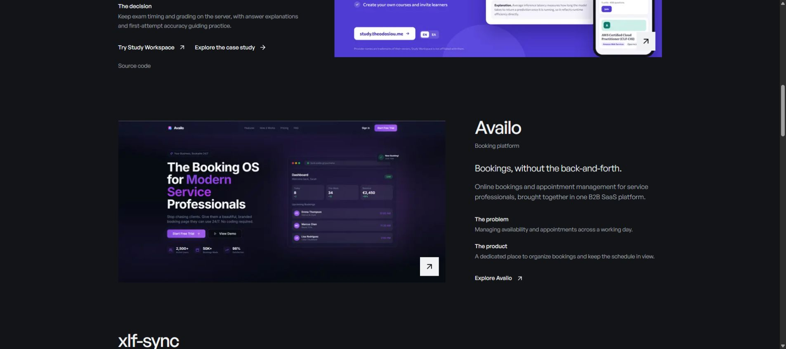

[](https://anastasios.theodosiou.me)

# Anastasios Theodosiou — Portfolio & Engineering Blog

My personal portfolio and engineering blog: selected products, project case studies, professional experience, and practical notes on building software. I am a full-stack software engineer based in Thessaloniki, Greece, working with JavaScript and TypeScript, with a specialization in Angular.

**Live website:** [anastasios.theodosiou.me](https://anastasios.theodosiou.me)

**Default and production release branch:** `master`

**Deployment:** manual GitHub Actions workflow → Contabo VPS → PM2

> Pushes and pull requests to `master` run validation. **Production deployment happens only when you manually select Run workflow on `master`.** A push, merge, or successful validation run does not deploy the site.

## Contents

- [The website](#the-website)
- [Technology](#technology)
- [Local development](#local-development)
- [Content and configuration](#content-and-configuration)
- [Project structure](#project-structure)
- [Checks and commands](#checks-and-commands)
- [Branches and GitHub Actions](#branches-and-github-actions)
- [Deploy to the live website](#deploy-to-the-live-website)
- [How deployment works](#how-deployment-works)
- [One-time deployment setup](#one-time-deployment-setup)
- [Update installed deployment scripts](#update-installed-deployment-scripts)
- [Troubleshooting and rollback](#troubleshooting-and-rollback)
- [Further documentation](#further-documentation)
- [Credits](#credits)

## The website

- **Portfolio:** selected work including Study Workspace, Availo, xlf-sync, Capmentor, and SeaSkills, with links to products, source code, and dedicated case studies where available.
- **About:** engineering background, work experience, education, contact details, and résumé.
- **Writing:** MDX articles with syntax highlighting, heading links, tags, pagination, reading times, and an RSS feed.
- **Presentation:** responsive layouts, light and dark themes, self-hosted General Sans fonts, and motion that respects reduced-motion preferences.
- **Search and sharing:** page metadata, canonical URLs, structured data, sitemap, robots rules, Open Graph images, and application icons/manifest.
- **Privacy:** analytics requires explicit consent; visitors can reject or withdraw it. GitHub/Giscus comments load only after the visitor chooses to load them. Legacy visitor-fingerprint registration endpoints are retired.

The image above is an actual screenshot of the live homepage, captured on **November 3, 2026**, and stored at [`docs/images/portfolio-homepage.jpg`](docs/images/portfolio-homepage.jpg).

## Technology

| Area | Implementation |
| --- | --- |
| Application | Next.js 16 App Router, React 19, TypeScript |
| Styling and UI | Tailwind CSS 3, shadcn/ui-style components, Radix UI, Lucide icons |
| Motion and themes | Framer Motion, next-themes |
| Content | MDX compiled with Velite; rehype plugins for code highlighting and heading links |
| Analytics | Google Analytics 4, loaded after consent |
| Comments | Giscus backed by GitHub Discussions, loaded on demand |
| Historical data | Mongoose/MongoDB for the legacy aggregate view-count read endpoint |
| Validation | ESLint, Node test runner, Bash syntax checks, ShellCheck, npm production audit |
| Production | Contabo Linux VPS, systemd deployment jobs, PM2, existing Cloudflare/HTTPS setup |

Development and production builds explicitly use webpack for the Velite content plugin. The lockfile defines exact installed dependency versions.

## Local development

Use **Node.js 22.12.0 or newer** and npm. CI uses Node 22; production pins the Node executable chosen during deployment-script installation.

```bash
git clone https://github.com/atheodosiou/personal-blog-nextjs.git
cd personal-blog-nextjs
git switch master
npm ci --include=dev
npm run dev
```

Open [localhost:3000](http://localhost:3000). Velite generates `.velite` during the Next.js build/dev pipeline; do not edit generated content by hand.

### Environment variables

Create `.env.local` for local development if needed, or `.env.production.local` for a local production build. Keep both out of Git.

| Variable | Purpose |
| --- | --- |
| `GAID` | GA4 Measurement ID. Leave empty to disable analytics locally. Production deployment checks require the configured portfolio ID, `G-E4G1QVX7T9`. |
| `MONGODB_URI` | Needed only for the historical view-count read API. The portfolio and MDX content do not require a database. Legacy view-writing endpoints remain retired. |
| `NEXT_BUILD_DIR` | Optional Next.js output directory; defaults to `.next`. Build and start with the same value. |
| `ANALYZE_CLIENT_BUNDLE` | Set to `1` during a build to enable the client bundle analysis plugin. |

[`.env.example`](.env.example) documents the analytics setting. On the VPS, deployment variables live in `/etc/portfolio-deploy/production.env`, copied into each release as `.env.production.local`.

### Local production build

```bash
npm run build
npm run start -- --port 3000
```

Build dependencies are required during compilation, so install with `--include=dev`. `npm run build:vm` and `start-server-and-build.sh` are build-only entry points; PM2 owns the production server lifecycle.

## Content and configuration

| What to change | Location |
| --- | --- |
| Name, bio, links, résumé, experience, education | [`config/site.ts`](config/site.ts) |
| Project data and case-study content | [`config/projects.ts`](config/projects.ts) |
| Topic descriptions | [`config/topics.ts`](config/topics.ts) |
| Homepage and pages | [`app/`](app/) |
| Blog articles | [`content/blog/`](content/blog/) |
| Images, résumé, public assets | [`public/`](public/) |
| Shared components | [`components/`](components/) |
| Global styles | [`app/globals.css`](app/globals.css) |
| MDX schema and processing | [`velite.config.ts`](velite.config.ts) |

Add an article as `content/blog/my-article.mdx`:

```mdx
---
title: "A practical engineering lesson"
description: "What I built, what I learned, and why it matters."
date: 2026-11-03
author: "Anastasios Theodosiou"
readTime: "5 min"
tags: ["TypeScript", "Architecture"]
published: true
---

Article content goes here.
```

The filename determines the article slug. Set `published: false` to exclude a draft from published content. Optional fields include `updated`, `keywords`, `header`, `devTo`, and `buymeacoffee`; see the Velite schema for the complete definition.

## Project structure

```text
.github/workflows/       GitHub Actions validation and manual deployment
app/                    App Router pages, metadata, feeds, and API routes
assets/fonts/           Self-hosted fonts
components/             Portfolio, navigation, MDX, consent, and UI components
config/                 Site identity, projects, and topic configuration
content/blog/           Authored MDX articles
docs/                   Deployment, analytics, privacy, SEO, and performance
lib/                    Content, metadata, consent, analytics, and utilities
public/                 Images, icons, résumé, and static assets
scripts/                HTTP checks, tests, and build analysis
scripts/deploy/         Server installer, orchestration, and PM2 helpers
```

## Checks and commands

| Command | Purpose |
| --- | --- |
| `npm run dev` | Start local development with webpack |
| `npm run build` | Compile MDX and build production assets |
| `npm run start -- --port 3000` | Serve an existing build locally |
| `npm run lint` | Run ESLint |
| `npm run test:consent` | Consent persistence, expiry, and invalid records |
| `npm run test:analytics` | Event classification and exclusion of private payloads |
| `npm run test:deploy` | Deployment, stale-commit rejection, rollback, SSH restrictions, and HTTP diagnostics |
| `npm audit --omit=dev` | Audit production dependencies |

With the application already running, pass its URL explicitly to HTTP checks:

```bash
npm run check:seo -- http://127.0.0.1:3000
npm run check:privacy -- http://127.0.0.1:3000
npm run check:deployment -- http://127.0.0.1:3000
```

The deployment check requires `GAID=G-E4G1QVX7T9` in the checking process environment **and** in the application build. It verifies GA4 configuration, manifest, and exact release icons. Set the variable first with `export GAID=G-E4G1QVX7T9` in Bash or `$env:GAID = 'G-E4G1QVX7T9'` in PowerShell. Standalone Node checks do not automatically load Next.js `.env` files.

Deployment tests use Bash. On Windows they expect Git Bash at `C:/Program Files/Git/bin/bash.exe`; CI runs on Ubuntu with Bash and ShellCheck available.

## Branches and GitHub Actions

**`master` is both the default branch and the production release branch.** The `rebranding-2026` redesign has been merged into it. Use feature branches and pull requests targeting `master` for subsequent changes.

The workflow is [`Portfolio checks and deployment`](.github/workflows/deploy-portfolio.yml).

| Event | Branch | Validate portfolio | Deploy to Contabo |
| --- | --- | --- | --- |
| Push | `master` | Runs | Skipped |
| Pull request | Targeting `master` | Runs | Skipped |
| Manual **Run workflow** | `master` | Runs | Runs after validation succeeds |
| Manual **Run workflow** | Another branch using this workflow revision | Branch guard rejects it | Skipped |

Validation runs on **Ubuntu 24.04 / Node 22**:

1. Install the lockfile, including development/build dependencies.
2. Run ESLint, consent tests, analytics tests, and deployment/rollback tests.
3. Run Bash syntax checks and ShellCheck on deployment scripts.
4. Audit production dependencies.
5. Report public HTTP reachability for diagnostics.

The public reachability report is diagnostic and does not block deployment. The former **Verify public HTTPS site** deployment step has been removed. Cloudflare challenges or edge-cache differences do not fail a healthy origin deployment, and the workflow does not change Cloudflare settings. Strict preview and origin checks still run on the VPS.

## Deploy to the live website

Once the one-time setup below is complete:

1. Merge the intended changes into `master` and push them to GitHub.
2. Open [GitHub Actions → Portfolio checks and deployment](https://github.com/atheodosiou/personal-blog-nextjs/actions/workflows/deploy-portfolio.yml).
3. Confirm **Validate portfolio** is green for the intended latest commit on `master`.
4. Select **Run workflow**, choose **Branch: master**, and click **Run workflow**.
5. Open the new **Manually run** execution. Wait for **Validate portfolio** and **Deploy to Contabo** to succeed.
6. Review the summary and server log for `DEPLOY PASSED`, the deployed `COMMIT`, and `RELEASE_DIR`.
7. Open [the live website](https://anastasios.theodosiou.me) and check the changed pages. For analytics changes, check accept/reject/withdrawal through **Cookie settings**; inspect GA4 only after explicitly accepting analytics.

**Keep `master` unchanged until deployment completes.** The VPS requires the requested SHA to be the latest `master` before preparation and again before replacing the running process. Even a documentation-only push can cause an in-progress deployment to be rejected as stale. Start a new manual run for the latest commit if that happens.

A **push-triggered green run confirms validation only**; its deployment job is skipped. Publishing needs a separate manual run. Re-running an old workflow execution keeps its original commit, so use a new **Run workflow** when the branch head has changed.

## How deployment works

```text
Manual workflow on master
  → Validate portfolio on the GitHub runner
  → Restricted SSH command: deploy <exact commit SHA>
  → Independent systemd job on Contabo
  → Fetch master and create a new release worktree
  → Install, lint, test, audit, and build
  → Preview on 127.0.0.1:3201 and run HTTP checks
  → Recheck master and the running PM2 process
  → Replace only PM2 app portfolio on port 3001
  → Verify origin, save PM2 state, report the deployed SHA
```

| Production item | Location / setting |
| --- | --- |
| Repository checkout | `/root/projects/personal-blog-nextjs` |
| Separate releases | `/root/projects/portfolio-releases` |
| PM2 application | `portfolio` |
| PM2 state directory | `/root/.pm2` |
| Live application port | `3001` |
| Temporary loopback preview | `127.0.0.1:3201` |
| Private production environment | `/etc/portfolio-deploy/production.env` |
| Pinned Node executable path | `/etc/portfolio-deploy/node-path` |
| Installed deployment command | `/usr/local/sbin/portfolio-deploy` |
| Restricted SSH entry point | `/usr/local/sbin/portfolio-deploy-ssh` |
| PM2 helper | `/usr/local/lib/portfolio-deploy/pm2-state.cjs` |
| Deployment lock | `/run/lock/portfolio-deploy.lock` |

Each attempt builds in a separate directory and previews before touching the live process. SEO, privacy, GA4 configuration, manifest, and icon checks run against the preview and final loopback origin. The public repository is fetched over HTTPS without a forwarded SSH agent.

Before switching, the script privately saves the previous app launch configuration. A handled failure during cutover triggers restoration of that configuration and a PM2 save. Other PM2 apps are left alone. Process replacement causes a brief interruption; deployment is not zero-downtime.

GitHub uses the `production` environment and `portfolio-production` concurrency group with `cancel-in-progress: false`. A server-side lock prevents overlapping deployments too. The systemd job has a 25-minute timeout and up to 120 seconds for termination/rollback. An SSH disconnect does not itself terminate the job; a canceled Actions run is not proof of server cancellation or rollback.

## One-time deployment setup

These steps configure the **existing Contabo installation**. They assume a running `portfolio` app under root’s PM2 namespace, its private `.env.production.local`, the repository checkout, and the releases directory already exist. Fresh VPS provisioning and HTTPS/reverse-proxy installation are outside the repository installer.

### 1. Prepare the server and a dedicated key

The server needs Node **22.12.0+**, npm, PM2, Git, Bash, curl, `ss`, `flock`, systemd, and OpenSSH. Select the intended Node in the root shell before installation: the installer pins that exact executable.

Generate a dedicated, unencrypted Ed25519 key locally with a new filename. Example in PowerShell:

```powershell
$portfolioKey = Join-Path $env:USERPROFILE '.ssh\portfolio-actions'
if (Test-Path -LiteralPath $portfolioKey) {
  throw 'Choose another filename; this key already exists.'
}
ssh-keygen -t ed25519 -C portfolio-actions -f $portfolioKey
# Leave both passphrase prompts empty for noninteractive Actions use.
Get-Content -LiteralPath "$portfolioKey.pub"
```

Only the public `.pub` key goes into the server installer. Store the private key in the GitHub environment secret below; never commit keys or application environment files.

### 2. Install the reviewed server scripts

In the trusted **root SSH session**, fetch and review the intended `master` revision, then install from a separate setup worktree:

```bash
(
  set -Eeuo pipefail
  umask 077
  cd /root/projects/personal-blog-nextjs
  git fetch origin master
  setup_commit=$(git rev-parse origin/master)
  setup_dir=$(mktemp -d /root/projects/portfolio-releases/actions-setup.XXXXXX)
  git worktree add --detach "$setup_dir" "$setup_commit"
  read -r -p 'Paste the public ssh-ed25519 deployment key: ' deploy_public_key
  bash "$setup_dir/scripts/deploy/install.sh" "$deploy_public_key"
)
```

The installer copies the scripts/helper, records the selected Node executable, and initializes the private production environment from the running release if missing. It adds the key to root’s `authorized_keys` with a restricted forced command accepting only `deploy <40-hex-sha>`; the key cannot open a shell or forward ports/agents. Installation does not restart the live app.

Build/application code still runs as root, matching this installation’s existing PM2 ownership. The restricted SSH command is not an application sandbox. Limit who can push release code and keep production branch restrictions in place.

### 3. Configure the GitHub production environment

In **Settings → Environments → production**, allow deployments only from exact branch **`master`**, with no tag rule. Optional required reviewers can be configured separately; the workflow already requires a manual run.

Add these **environment secrets**:

| Secret | Value |
| --- | --- |
| `PORTFOLIO_SSH_HOST` | Contabo SSH hostname or IPv4 address |
| `PORTFOLIO_SSH_KEY` | Entire dedicated private key, including BEGIN/END lines |
| `PORTFOLIO_SSH_KNOWN_HOSTS` | Verified VM host public key line, prefixed with its SSH host |

The installer prints the public host key. Verify it through the trusted connection, not an unverified CI `ssh-keyscan`. For port 22:

```text
YOUR_SSH_HOST ssh-ed25519 AAAA...verified-host-public-key...
```

For another port, use `[YOUR_SSH_HOST]:PORT` and set the environment **variable** `PORTFOLIO_SSH_PORT` (default `22`).

Application secrets stay on the VPS. The production GA4 ID is intentionally public and fixed in the script/workflow. After setup, follow the normal [manual release procedure](#deploy-to-the-live-website).

## Update installed deployment scripts

Installed files under `/usr/local` **do not update themselves when code is merged or deployed**. When `scripts/deploy/` changes, review and update the installed files from a trusted root session. Re-run the reviewed installer when the SSH entry point, PM2 helper, or selected Node installation changes.

For changes to **only** `portfolio-deploy.sh`, including the `rebranding-2026` → `master` migration, install the reviewed script without restarting the site:

```bash
(
  set -Eeuo pipefail
  umask 077
  exec 9>/run/lock/portfolio-deploy.lock
  flock -n 9
  cd /root/projects/personal-blog-nextjs
  git fetch --no-tags https://github.com/atheodosiou/personal-blog-nextjs.git \
    refs/heads/master:refs/remotes/origin/master
  read -r -p 'Paste the reviewed full master commit SHA: ' reviewed_sha
  [[ "$reviewed_sha" =~ ^[a-f0-9]{40}$ ]]
  [[ $(git rev-parse refs/remotes/origin/master) == "$reviewed_sha" ]]
  migration_script=$(mktemp /usr/local/sbin/.portfolio-deploy.XXXXXX)
  trap 'rm -f -- "$migration_script"' EXIT
  git show "$reviewed_sha:scripts/deploy/portfolio-deploy.sh" > "$migration_script"
  bash -n "$migration_script"
  chmod 755 "$migration_script"
  mv -f -- "$migration_script" /usr/local/sbin/portfolio-deploy
  echo 'Deployment script updated.'
)
```

The branch migration also requires the `production` environment branch rule to allow `master`. Once both are updated, ordinary content/application changes do not need this migration repeated.

## Troubleshooting and rollback

Start with the failed Actions step. If SSH fails or a run is canceled, inspect the VPS before starting another deployment:

```bash
systemctl list-units 'portfolio-deploy-*' --all
journalctl --unit='portfolio-deploy-*' --since '30 minutes ago' --no-pager
pm2 describe portfolio
pm2 logs portfolio --lines 40 --nostream
```

| Symptom | Action |
| --- | --- |
| Deployment skipped after a push | Expected. Start a new manual workflow run on `master`. |
| Wrong-branch/environment rejection | Select `master` and verify the `production` branch rule. |
| `The branch changed` | Start a new manual run for the latest `master` commit. |
| `Another deployment is running` | Inspect the systemd job and wait; do not delete the lock. |
| SSH/host-key failure | Check host, port, dedicated key, and verified known-hosts secret. Keep host-key verification enabled. |
| Missing/unsupported pinned Node | Select Node 22.12.0+ and re-run the reviewed installer. |
| Preview/build/check failure | Cutover has not started; the running release is preserved. Inspect logs and fix the failure. |
| `ROLLBACK PASSED` | Previous process configuration was restored and saved. Check the running site before retrying. |
| `ROLLBACK NEEDS ATTENTION` | Inspect immediately; the private rollback configuration and old release remain available for recovery. |
| Healthy origin, different public response | Compare deployed SHA/origin with the public site, then investigate the existing edge/cache configuration separately. |

Logs print `COMMIT`, `RELEASE_DIR`, and the private rollback configuration path. Use them to identify the release, rather than an old documented directory. Never rebuild/delete a directory still referenced by PM2 or a rollback configuration.

Handled cutover failures attempt automatic rollback. Power loss, SIGKILL, or VM failure cannot run shell traps. For manual recovery, use the exact saved configuration under the deployment lock, restore only `portfolio`, verify HTTP and the process directory, then save PM2 state. Review the saved file privately before use; it contains application environment values. Avoid global PM2 restarts or unrelated process changes.

## Further documentation

| Guide | Contents |
| --- | --- |
| [GitHub Actions deployment](docs/github-actions-deploy.md) | Installer behavior, SSH restrictions, branch migration, timeouts, operations |
| [Contabo / PM2 deployment](docs/deploy.md) | Manual release background, build requirements, process lifecycle, historical verification notes |
| [Analytics](docs/analytics.md) | GA4 configuration, events, consent, verification |
| [Privacy](docs/privacy.md) | Data handling, policies, operational follow-ups |
| [SEO](docs/seo.md) | Metadata, crawling, indexing, checks |
| [Performance](docs/performance.md) | Measurements, changes, remaining observations |

## Credits

The repository began from a Next.js/MDX/Velite blog template with an accompanying [video tutorial](https://youtu.be/tSI98g3PDyE). The original README credited [shadcn/ui](https://ui.shadcn.com/) and [Taxonomy](https://tx.shadcn.com/) as design influences. It has since evolved into this personal portfolio, engineering blog, and Contabo deployment setup. Font attribution is recorded in [`assets/fonts/README.md`](assets/fonts/README.md).
